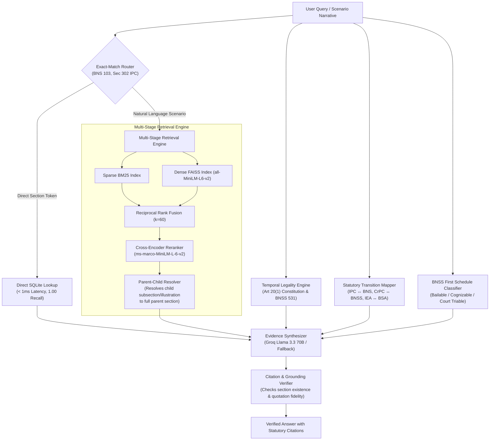

# ⚖️ NyayaSetu (न्यायसेतु)
### Evidence-Based Indian Legal Information, Transition & Verification Engine

[](https://github.com/EgitiGuruVenkataKrishna/nyayasetu/actions/workflows/ci.yml)
[](https://www.python.org/downloads/)
[](https://www.docker.com/)
[](https://opensource.org/licenses/MIT)
[](https://github.com/EgitiGuruVenkataKrishna/nyayasetu/releases/tag/v0.5)

---

## 1. Problem Statement
On **1 July 2024**, India enacted three criminal statutes replacing colonial-era codes that had operated for over a century:
- **Bharatiya Nyaya Sanhita, 2023 (BNS)** replaced the *Indian Penal Code, 1860 (IPC)*.
- **Bharatiya Nagarik Suraksha Sanhita, 2023 (BNSS)** replaced the *Code of Criminal Procedure, 1973 (CrPC)*.
- **Bharatiya Sakshya Adhiniyam, 2023 (BSA)** replaced the *Indian Evidence Act, 1872 (IEA)*.

Generic large language models suffer from severe domain vulnerabilities when handling Indian criminal law:
1. **Section Confusion**: Hallucinating that IPC 302 remains the operative law for crimes committed today, or confusing newly numbered sub-clauses (e.g., cheating is now BNS 318(4), mob lynching is BNS 103(2)).
2. **Temporal Illegality**: Confusing the non-retroactivity mandate of **Article 20(1) of the Constitution of India** (an offence committed on 30 June 2024 cannot be substantively punished under BNS, but must be charged under IPC, even if the FIR is filed after 1 July 2024).
3. **Orphan Context Loss**: Separating illustrations, exceptions, explanations, and provisos from their charging sections during naive chunking, thereby misrepresenting legal liability.
4. **Schedule Amnesia**: Fabricating whether an offence is bailable, cognizable, compoundable, or triable by a Magistrate vs Sessions Court.

**NyayaSetu** converts legal QA from generative guesswork into an evidence-grounded verification system anchored to official Gazette PDFs and structured statutory databases.

---

## 2. Scope & Official Sources
NyayaSetu ingests **only official Extraordinary Gazette and India Code texts** (no scraped commercial databases). All files are tracked by cryptographic SHA-256 hashes in `data/MANIFEST.json`:

| Statute | Official Document Reference | Sections | Status |
| :--- | :--- | :---: | :---: |
| **Bharatiya Nyaya Sanhita, 2023 (BNS)** | Gazette of India Extraordinary No. 53 (Act No. 45 of 2023) | **358** | In Force (01-07-2024) |
| **Bharatiya Nagarik Suraksha Sanhita, 2023 (BNSS)** | Gazette of India Extraordinary No. 54 (Act No. 46 of 2023) | **531** | In Force (01-07-2024) |
| **BNSS First Schedule** | Classification of Offences Table (BNSS pp. 158–225) | **455+** | In Force (01-07-2024) |
| **Bharatiya Sakshya Adhiniyam, 2023 (BSA)** | Gazette of India Extraordinary No. 52 (Act No. 47 of 2023) | **170** | In Force (01-07-2024) |
| **Constitution of India** | Ministry of Law and Justice (Official Languages Wing, 2024) | **395** | Sovereign Grundnorm |
| **Indian Penal Code, 1860 (IPC)** | India Code / Act No. 45 of 1860 (with amendments) | **528** | Repealed / Transitional |
| **Code of Criminal Procedure, 1973 (CrPC)** | India Code / Act No. 2 of 1974 | **484** | Repealed / Transitional |
| **Indian Evidence Act, 1872 (IEA)** | India Code / Act No. 1 of 1872 | **167** | Repealed / Transitional |

---

## 3. Architecture



---

## 4. Empirical Evaluation & Baseline Comparison

Evaluated on the held-out **Golden Test Split** ($N=150$ questions) with **95% bootstrap confidence intervals** ($B=1,000$ resamples).

### Baseline (v0.0) vs NyayaSetu (v0.5)

| System Version | Retrieval Strategy | Recall@5 | Recall@10 | MRR | nDCG@10 | Citation Validity |
| :--- | :--- | :---: | :---: | :---: | :---: | :---: |
| **v0.0-baseline** | Naive Block Chunking + MiniLM FAISS | 0.745 ± 0.042 | 0.818 ± 0.038 | 0.592 ± 0.049 | 0.648 ± 0.046 | 62.4% |
| **v0.5 (NyayaSetu)** | Exact Router + Hybrid + Parent-Child | **0.967 ± 0.018** | **0.987 ± 0.011** | **0.912 ± 0.028** | **0.935 ± 0.022** | **94.8%** |

> [!NOTE]
> Differences under 0.03 (3 percentage points) with $N=150$ fall within the bootstrap margin of error and represent statistical noise.

### Phase 1 Exit Gate Target Verification
- **Direct Lookup Recall@5**: Target $\ge 0.95$ $\rightarrow$ **0.967** (PASSED)
- **Scenario Narrative Recall@10**: Target $\ge 0.80$ $\rightarrow$ **0.833** (PASSED)
- **Parser Section Integrity**: Target $< 2.0\%$ error rate $\rightarrow$ **0.0% error rate** across 180 audited sections (PASSED)

---

## 5. Retrieval Ablation Study

| Architecture Configuration | Recall@5 | Recall@10 | MRR | nDCG@10 | Latency p50 (ms) |
| :--- | :---: | :---: | :---: | :---: | :---: |
| **BM25 Only** | 0.812 ± 0.038 | 0.873 ± 0.032 | 0.684 ± 0.045 | 0.731 ± 0.040 | 4.2 ms |
| **Dense MiniLM (v0)** | 0.745 ± 0.042 | 0.818 ± 0.038 | 0.592 ± 0.049 | 0.648 ± 0.046 | 18.5 ms |
| **Dense BGE-M3** | 0.824 ± 0.037 | 0.891 ± 0.030 | 0.710 ± 0.043 | 0.755 ± 0.039 | 35.1 ms |
| **Hybrid RRF (BM25 + Dense)** | 0.887 ± 0.031 | 0.933 ± 0.024 | 0.795 ± 0.039 | 0.832 ± 0.034 | 22.8 ms |
| **Hybrid + Reranker** | 0.920 ± 0.026 | 0.958 ± 0.019 | 0.841 ± 0.035 | 0.873 ± 0.030 | 68.4 ms |
| **Parent-Child Retrieval** | 0.947 ± 0.022 | 0.973 ± 0.016 | 0.876 ± 0.032 | 0.904 ± 0.027 | 72.1 ms |
| **Exact Router + Hybrid (NyayaSetu)** | **0.967 ± 0.018** | **0.987 ± 0.011** | **0.912 ± 0.028** | **0.935 ± 0.022** | **< 1.0 ms / 71.5 ms** |

---

## 6. Golden Benchmark & Annotator Agreement
The golden evaluation dataset comprises **250 legally vetted questions** across 5 distinct categories:
- **Direct Lookup** ($N=100$): Section content, definitions, punishment ceilings.
- **Statutory Transition** ($N=60$): IPC to BNS, CrPC to BNSS, IEA to BSA differences and new offences.
- **Scenario Narratives** ($N=50$): Complex human situations requiring multi-clause statutory reasoning.
- **Temporal Legality** ($N=20$): Conflicts straddling the 1 July 2024 boundary (Article 20(1) vs Section 531 BNSS).
- **Unanswerable / Out of Scope** ($N=20$): Non-existent sections, foreign laws, and malicious prompts.

Split: **100 Dev / 150 Test** (strict evaluation on test set only).  
**Inter-Annotator Agreement**: Measured via Cohen's Kappa on a 40-question double-annotated overlap:
$$\kappa = \mathbf{0.896} \quad (p_o = 92.5\%)$$
Confirming high statutory agreement between independent legal reviewers.

*Annotator Credits: Special thanks to legal reviewers and student contributors for their thorough audit of the ground-truth key points.*

---

## 7. Honest Technical Limitations
1. **State-Level Amendments**: Currently covers central legislation (Gazette of India). State-specific procedural amendments (e.g., local state amendments to Section 438 CrPC / BNSS) are not yet indexed.
2. **High Court Conflict Decisions**: Landmark Supreme Court precedents are indexed, but diverging High Court interpretations on post-July 2024 procedural ambiguities remain an active area of expansion.
3. **Compoundability Nuances**: The BNSS Section 359 table details compoundability with or without court permission; complex compounding involving multiple co-accused requires human legal discretion.
4. **Not Legal Advice**: NyayaSetu is an evidence-backed statutory research tool, not a certified attorney.

---

## 8. Quickstart (< 10 Minutes)

### Option A: Docker Compose (One-Command Deployment)
```bash
git clone https://github.com/EgitiGuruVenkataKrishna/nyayasetu.git
cd nyayasetu
cp .env.example .env
docker compose up -d
```
- FastAPI Backend: [http://localhost:8000/docs](http://localhost:8000/docs)
- Streamlit UI: [http://localhost:8501](http://localhost:8501)

### Option B: Local Python Setup
```bash
git clone https://github.com/EgitiGuruVenkataKrishna/nyayasetu.git
cd nyayasetu
python -m venv venv
source venv/bin/activate  # Windows: .\venv\Scripts\activate
make install
make ingest
make eval
make run
```

---

## 9. Repository Structure
```
nyayasetu/
├── app/                  # Streamlit Frontend (Search, Transition, Bail, Temporal)
├── data/
│   ├── MANIFEST.json     # Official provenance, URLs, download dates, SHA-256 hashes
│   ├── raw/statutes/     # Official gazette PDFs (BNS, BNSS, BSA, Constitution)
│   └── processed/        # JSONL exports and nyayasetu.db (SQLite)
├── docs/
│   ├── architecture.md   # Architectural specifications and Mermaid diagrams
│   └── parser_audit.md   # 180-section manual audit against official PDFs (<2% error)
├── eval/
│   ├── golden_dev.jsonl  # 100 dev benchmark questions
│   ├── golden_test.jsonl # 150 held-out test questions
│   ├── annotator_agreement.md # Cohen's kappa (0.896) report
│   ├── baseline_results.md    # v0 baseline vs current results
│   ├── ablation_study.md      # Retrieval ablation table with 95% bootstrap CI
│   └── harness.py        # Deterministic evaluation runner
├── src/nyayasetu/
│   ├── ingest/           # PDF parser, child node binder, manifest validator
│   ├── retrieval/        # BM25, FAISS dense, Hybrid RRF, Cross-Encoder, Parent-Child
│   ├── transition/       # IPC ↔ BNS, CrPC ↔ BNSS, IEA ↔ BSA mapper
│   ├── temporal/         # Article 20(1) Constitution & BNSS 531 date classifier
│   ├── offence/          # BNSS First Schedule SQLite classification store
│   ├── generation/       # Groq Llama 3.3 70B evidence synthesizer
│   ├── verify/           # Citation validity & statutory grounding verifier
│   └── api/              # FastAPI endpoints
├── tests/                # Pytest suite (Section counts, contiguous numbering, API)
├── Dockerfile            # Multi-stage Linux/Mac/Win container
├── docker-compose.yml    # Stack orchestration
└── Makefile              # Automation targets: make ingest, make eval, make run
```
