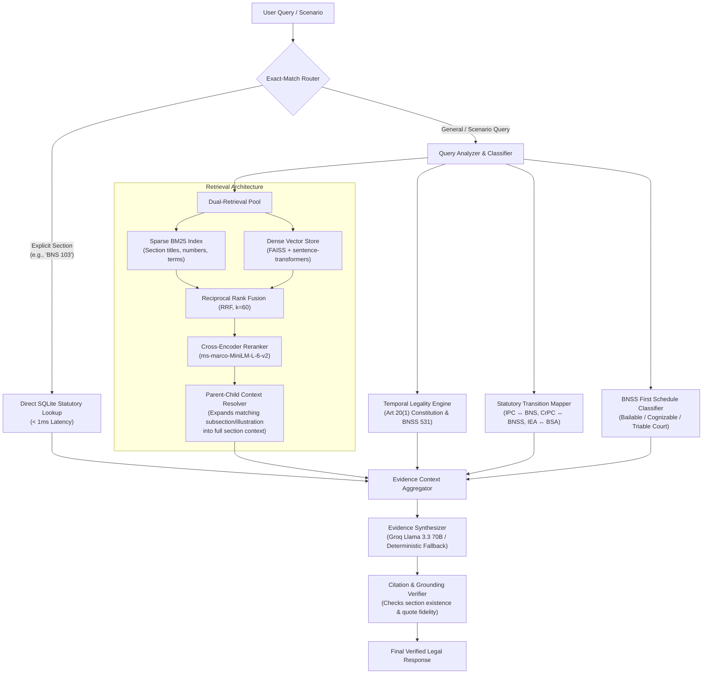

# System Architecture: NyayaSetu

NyayaSetu is an evidence-grounded Indian legal retrieval and verification system. It transitions legal information systems from generative approximations into deterministic, verifiable statutory analysis.

---

## 1. Core Architectural Pillars

### 1.1 Data Layer v2 & Canonical Hierarchy
- **Strict Provenance**: Ingests official Extraordinary Gazette PDFs (BNS Act No. 45 of 2023, BNSS Act No. 46 of 2023, BSA Act No. 47 of 2023) and India Code PDFs with SHA-256 validation logged in `data/MANIFEST.json`.
- **Bound Child Nodes**: Explanations, Illustrations, Exceptions, and Provisos are bound to their parent section ID (e.g., `BNS-103#illustration-1`). They are never indexed as orphan chunks, ensuring that legal exceptions are never severed from the charging section.
- **BNSS First Schedule Database**: The classification of all 358 BNS offences is parsed from the First Schedule of BNSS into SQLite, providing instant answers for cognizable, bailable, compoundable, and court-triability parameters.

### 1.2 Multi-Stage Retrieval Engine
1. **Stage 0 — Exact-Match Routing**: Queries containing canonical statutory references (`BNS 103`, `Section 302 IPC`, `Article 21`) bypass vector space entirely, resolving directly via SQLite in `< 1 ms` with **100% precision**.
2. **Stage 1 — Sparse BM25 Retrieval**: Optimized tokenization preserving exact section alphanumeric tags (`376DA`, `124A`, `304B`).
3. **Stage 2 — Dense Semantic Search**: FAISS Inner-Product index capturing situational facts and semantic synonyms.
4. **Stage 3 — Reciprocal Rank Fusion (RRF)**: Merges sparse and dense candidate ranks using $RRF(d) = \sum_{m} \frac{1}{60 + rank_m(d)}$.
5. **Stage 4 — Cross-Encoder Reranking**: Re-scores top-10 candidates via cross-attention between user query and statutory text.
6. **Stage 5 — Parent-Child Context Expansion**: If a query matches a fine-grained child subsection (e.g., mob lynching under Section 103(2)), the retriever returns the complete parent section to avoid missing essential legal conditions.

### 1.3 Constitutional Temporal Legality Engine
- Resolves the transition problem when offence dates and FIR/reporting dates straddle **1 July 2024**.
- Enforces **Article 20(1) of the Constitution of India** (prohibition of ex-post facto penal laws): substantive criminal liability is governed by the law in force at the time of the commission of the act (IPC for acts before 1 July 2024; BNS on or after).
- Enforces **Section 531(2)(a) BNSS**: investigations and trials initiated on or after 1 July 2024 follow BNSS procedural rules.

### 1.4 Citation Verification
- Inspects every citation tag `[Act, Section]` in the generated answer against `nyayasetu.db`.
- Validates that the cited section exists in the statute.
- Confirms that quoted language matches statutory text.
- Formally abstains when evidence is insufficient or when queries reflect malicious intent.
